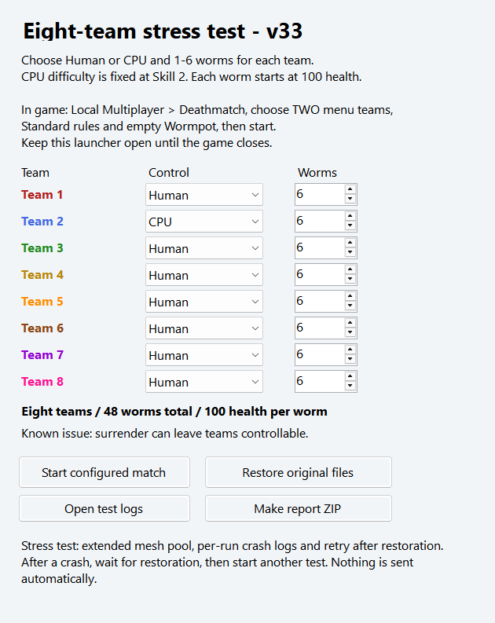

# Worms 4 Mayhem — 8 Teams, 6 Worms

An experimental mod and Windows launcher for **eight teams**, with **1–6 worms per team**: up to **48 worms** in one local match. Choose **Human or CPU** separately for each team.

**Current build: v33. Some matches complete successfully, but crashes and gameplay bugs remain.** This is a testing release, not a fully stable mod.

## Download and play

**[Download the v33 launcher ZIP](https://github.com/gylala999/Worms4-8Teams-6Worms/raw/refs/heads/main/W4-EightStressTest-v33.zip)** · [Report a bug](https://github.com/gylala999/Worms4-8Teams-6Worms/issues)

1. Use your own **Worms 4 Mayhem, build 3013** installation. The launcher verifies the executable and five data files by SHA256. Other builds, edited data and Worms Ultimate Mayhem are not supported by this release.
2. Extract the ZIP into your game folder. Keep `W4-EightStressTest-v33.exe` and its `CodexTeamTest` folder beside `WORMS 4 MAYHEM.EXE`.
3. Open the launcher and choose Human/CPU and 1–6 worms for each of the eight teams.
4. In the game, select **Local Multiplayer → Deathmatch**, choose **TWO menu teams**, then use **Standard rules and an empty Wormpot** for the first test.
5. Keep the launcher open until the game closes and it verifies that the original files are restored.

CPU difficulty is currently fixed at **Skill 2**. Initial health is **100 per worm**. Appearance comes from the first selected menu team; the launcher does not yet provide separate name or appearance editors. This project has been tested in local matches; online eight-player networking has not been established.

The ZIP contains the mod launcher and modified Lua/XML payloads. You supply the game. The launcher patches its child game process in memory; the original game executable is not changed on disk. It creates verified local backups and temporarily replaces the five data files, then restores them when the game exits. If restoration fails, close the game and use **Restore original files** before continuing.

## What has worked in testing?

- Eight teams with six worms each loaded and played.
- An alternating **Human/CPU/Human/CPU** setup completed a full match on v31. Teams 1 and 3 were eliminated, and **Team 5 won alone**.
- A custom human team with seven CPU teams was reported to work. Custom appearance, rules and Wormpot bonuses were also tried; this does not establish that every mode or bonus combination is supported.
- Inventory opening, CPU turns, eliminations and victory handling passed in recorded tests after earlier fixes.
- In the latest v33 stress session, crowded explosions, knockouts and drowning proceeded, with three completed round-stat imports before a later crash.

These are specific observations, not a guarantee that the same setup will never crash. See [TESTING.md](TESTING.md) for the development history and isolated checks.

## Why v33? What are the 4096 slots?

Earlier crowded Cluster Bomb tests exhausted the game's **550-entry mesh-instance pool** and crashed. v33 promotes that standard allocation to **4096 mesh entries**, while retaining native allocation/release behavior and the in-use guard.

**4096 is a rendering mesh pool capacity, not a worm count. The match maximum here is 8 × 6 = 48 worms.** Several actor/cache paths were also expanded to 64 entries. Increasing one pool does not fix every original four-team or sixteen-worm assumption.

The latest v33 crash had **3566 mesh entries free**, so that failure was a different problem. A null weapon/effect resource lookup after a Bazooka/terrain-destruction sequence remains under investigation.

## Known issues

- **Crashes remain.** The latest captured v33 failure was an access violation at `0x0041E0D1` after a Bazooka test. The exact missing resource and why its lookup failed are still unknown.
- Sheep, Old Woman and Super Sheep contact/detonation behavior was reported to fail near **Teams 5–8**. CPU attacks in general can target all eight teams; this is a separate walking-weapon problem.
- Alien UFO worm pickup was reported to fail; the affected setup still needs reproduction.
- After an explosion removes supporting terrain, an idle worm can stay suspended. Moving it a short distance, approximately 0.1 m in the report, makes it fall. The cause has not been confirmed.
- Surrender can leave a team controllable.

## Friend testing and crash reports

Friends can download the ZIP and test with their own compatible game installation. Start with Standard rules and no Wormpot bonuses, then vary one setting at a time.

If the game crashes, **keep the launcher open**, wait for restoration, and use **Open test logs**. Each run has a separate report folder. Add your map, rules, bonuses, weapon/action and team setup to `tester-notes.txt`. **Make report ZIP** packages the report locally; nothing is uploaded automatically. You can start another match after restoration, and previous reports stay saved.

Open a [GitHub Issue](https://github.com/gylala999/Worms4-8Teams-6Worms/issues) using the questions in [BUG_REPORT.md](BUG_REPORT.md). Remove personal paths before attaching logs. Do not post memory dumps, original game files or original backups publicly. Bug reports are welcome; reproduction and fixes may take time, and a fix for every report is not promised.

## Source and building

The launcher, native patch modules, Lua/XML payloads and isolated test sources are included. See [BUILD.md](BUILD.md). The published ZIP is the preserved v33 package used for testing. Source builds can have a different executable or ZIP hash.

## Credits and license choice

**GyLala / gylala999:** idea, direction, gameplay testing, screenshots and bug reports.

**OpenAI Codex:** assistance with source code, launcher development, debugging, crash analysis and isolated checks. This is an unofficial community experiment; it is not an official OpenAI or Team17 release.

No license has been selected for this repository. Source is published for inspection and debugging; the repository does not claim an open-source license. Worms 4 Mayhem and its original game content belong to their respective owners.
